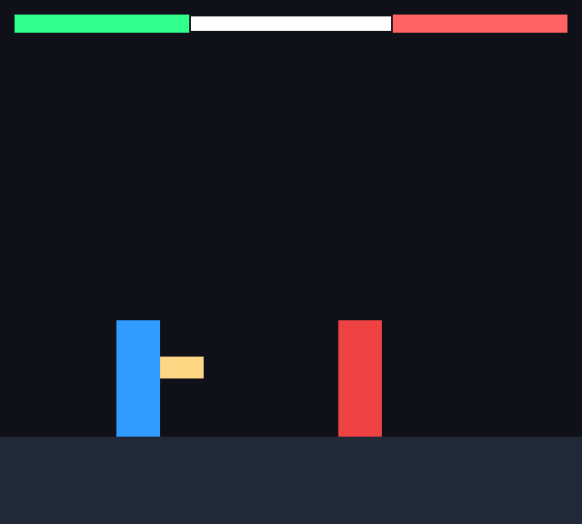
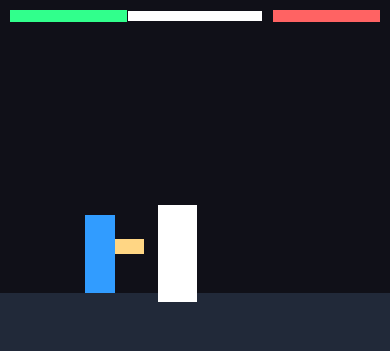
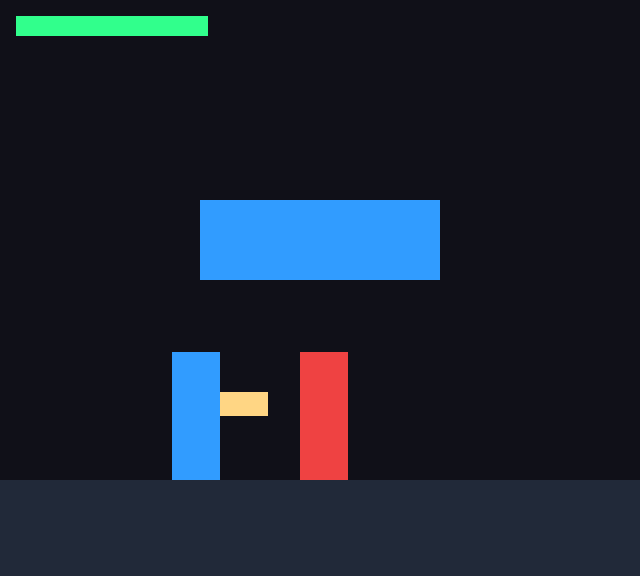
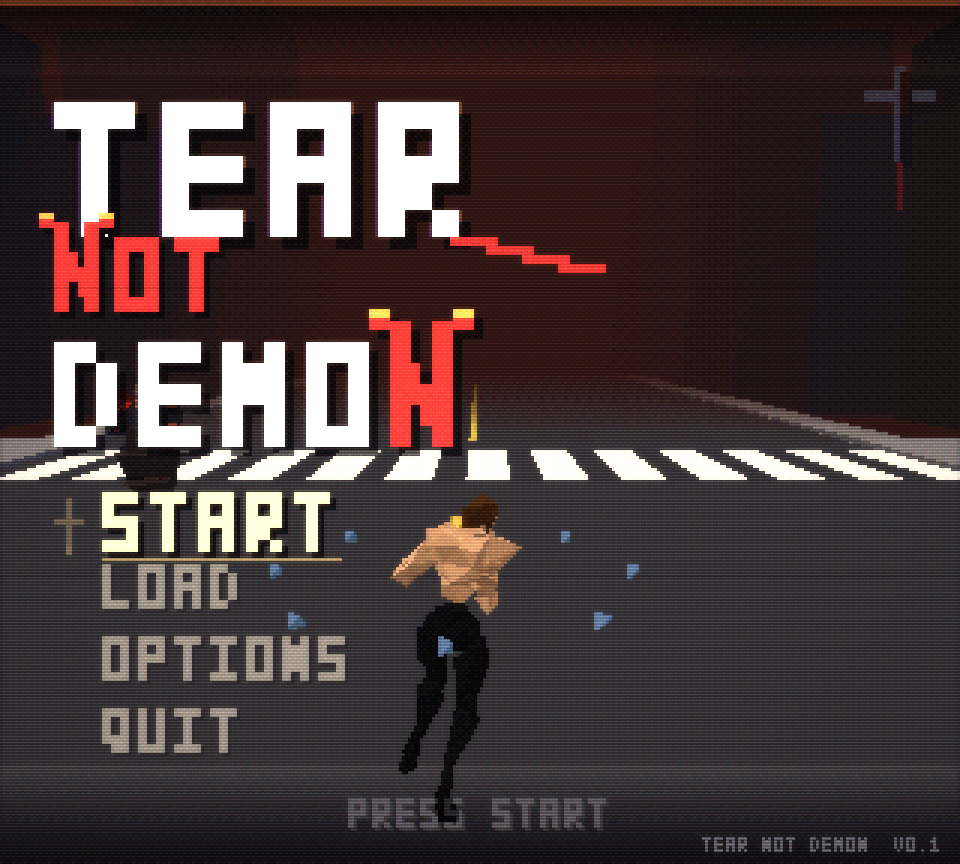
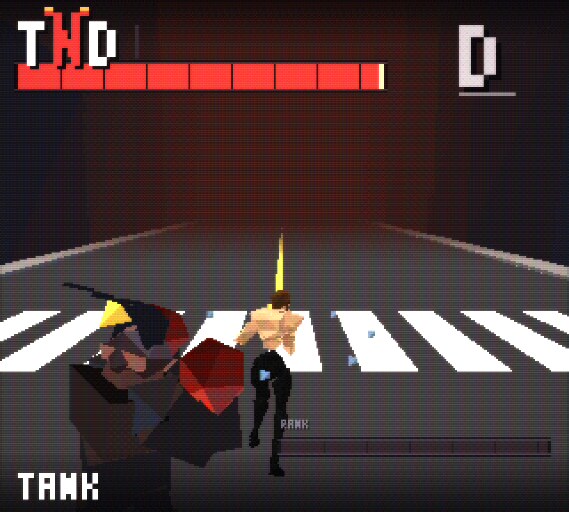
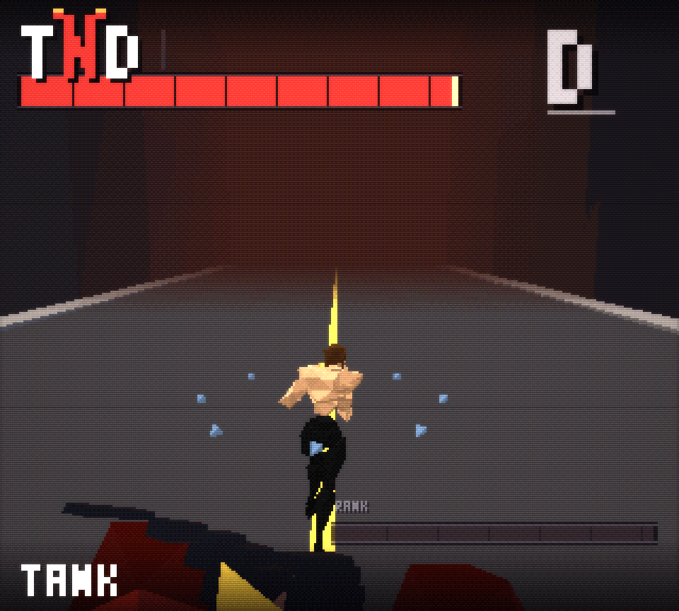

# FLAGSHIP — TEAR, assessed

An assessment of TEAR (`carts/tear.zol`) as the candidate flagship
first-party title, against the project's own charge: "thirty-nine
carts, zero with a goal, a fail state and a player loop." Written
2026-11-18, from the code, the tests, the July 2026 archive, and the
spec (`zeta-sdk/docs/ZETA0.md` §7, `AXES.md`).

## a. What TEAR is today

`carts/tear.zol` is 611 lines of pure ZOL, no generator script. It is
the only cart in the tree with a goal, a fail state and a loop — small,
but real on all three counts.

The machine's own frames, dumped headless under the balance test's
pads (`docs/images/gen_shots.py` — the frames are found by reading the
cart's state cells, so the shots regenerate from any build):

|  |  |  |
|---|---|---|
| frame 24: the stance. Two fighters, two health bars. | frame 64: a hit lands — the fist's one active frame, the enemy flashed white, its bar already shorter. | frame 195: the KO. The banner takes the winner's colour; the emptied bar is gone. |

Two coloured rectangles and a fist — the honest kernel, exactly as
inventoried below. Stage 4 of the plan is the distance from this to
two lit 700-face characters over a path-traced plate.

Measured inventory:

- **State**: 15 cells (16..30) — positions, two 96-point health bars,
  two 14-frame punch timers, hit-flash counters, a KO freeze counter,
  a winner flag, facing, and scratch. The `.data 16` line is the whole
  initial world.
- **Display**: a fixed 20-triangle list at 12288. Floor, two bodies,
  two fists, two health bars (bar width IS the health value), two
  hit flashes, a KO banner tinted the winner's colour. Hidden shapes
  park at x=-100 and are clipped away — a display list that never
  changes length, only words.
- **Player loop**: move left/right at 2 px/frame, punch on A — a
  14-frame swing whose hit lands on exactly one frame (timer == 10),
  for 12 damage and 18 px of knockback, range 52.
- **Opponent**: walks in when |dx| ≥ 48, swings every 32 frames
  (`frame & 31`). One rule, but it is an opponent: the idle player
  loses.
- **Win/lose**: empty a bar → 120-frame freeze on the winner's
  banner → full reset. Goal, fail state, loop — all present.
- **Sound**: three voices, all state-driven: a pulse whoosh rising
  300→950 Hz across the swing, a ~60 Hz triangle thud plus noise
  crack whose volume fades with the hit flash, and a KO siren that
  wobbles down the countdown.
- **Tests** (`tests/test_tear.py`, 45 lines, 3 tests): the AI beats an
  idle player within 1500 frames; a player holding RIGHT+A beats the
  AI within 3000 frames; the round freeze ends in an exact reset.
  These are balance proofs, not smoke tests — they pin that the game
  has a losable fight and a winnable one, by replaying pads.

What it lacks: one move, no blocking, no jumping, no rounds-to-win,
no second human player (the enemy reads no pad), no menu, no
timer, no character identity, flat quads for bodies. It is the
honest kernel of a fighting game, roughly a tech demo's distance
from a game you would name.

## b. What the July TND version had, and lost

`archive/TND/` is the pre-SDK TEAR — **TEAR NOT DEMON**, as its own
start menu spells it. Captured from the archive, running headless
today (`docs/images/gen_shots_tnd.py`, scripted keys, the game's own
renderer):

|  |  |  |
|---|---|---|
| The gothic start menu — START/LOAD/OPTIONS/QUIT, the fighter sprinting the crosswalk behind it. | Bancroft and Shattuck: the rigged boxer mid-stride, an enemy's angular mass in the foreground, segmented health, the RANK meter, TANK mode. | The aftermath — a downed enemy at the kerb, the style trail still hanging off the swing. |

This is the gap between the two TEARs made visible: the ZOL kernel in
section (a) is rectangles with correct rules; this had a *body*, a
street, and a mood — on the weaker machine. `src/zeta/virtual/tear.py`
alone is 5,461 lines, plus `combat.py`, `riglab.py`, a GOZL rules
variant, and `docs/TEAR.md` — a finished design document. Different
machine, different toolchain: none of it ports as code. As design, it
held:

- **An input grammar**: tap (≤9f) / hold (10f) / chord (two buttons in
  3f) / tap strings (22f window), with a 10-frame input buffer. Four
  buttons read for *how* they are pressed.
- **A real moveset with published frame data**: alternating jabs, a
  hook on the third tap, a launcher chord, a gun with a charged hold,
  a 56-frame special — startup/active/recovery/damage/hitstop per
  move, and a one-way cancel lattice (jabs → everything, special →
  nothing).
- **A style meter that punishes repetition** (payout decays 100 → 60
  → 40 → 25% over the last five moves), ranks D..SSS, combo
  multiplier, 55% loss on being hit, idle bleed — and **music layered
  by rank** (bass at C, arpeggio at B, lead at S), so the score is
  audible.
- **Locational damage**: chin vs gut tested in 3D against the posed
  skeleton; head hits pay 1.35× and extra hitstop. Hitstop itself.
  Whiff vs connect distinguished by ear.
- **A movement state machine**: survival/action tank × target
  off/on — BASE, AIM, PARKOUR, BOXING, PROWLER, FENCING, METEOR —
  with a double jump whose second press is a directional flip, and
  style chains for threading modes.
- **Enemies whose weakness is geometric**: slow walk, 1.75-second
  180° turn, a 24° attack cone, reach that comes from forearm length,
  mass-weighted collision. Three builds per wave.
- **Presentation**: an attract intro, a start menu
  (START/LOAD/OPTIONS/QUIT), a real JSON progress save, a death beat
  (46 frames before the DOWN screen), persistent best score, a
  demonic TND wordmark, a riglab (frame-data/pose inspector), and a
  live-redefinable GOZL rules layer.

That is a character-action design (closer to DMC than Street
Fighter), but nearly all of it transfers to a versus fighter: the
input grammar, frame data, cancels, hitstop, locational hits, the
audible meter, the menu/save shell. All of it is content — it was
built once on a weaker contract, so it is known to fit a 60 Hz,
few-actor machine.

## c. The gap to "a goal, a fail state and a player loop"

tear.zol already clears the literal bar — the only cart that does.
The real gap is from *kernel* to *game someone chooses to play*:

1. **One move is not a decision.** A fight is interesting when both
   players hold options that beat each other. Minimum: a second
   attack, a block or a backstep with cost, and throws or a
   high/low so blocking is not absolute.
2. **The opponent reads no pad.** The genre's whole claim on this
   machine is two humans on a link; today pad 2 does not exist in the
   cart.
3. **No match structure.** One KO loops forever; no best-of-three,
   no timer, no screen that says the match ended.
4. **No identity.** Two coloured rectangles. The envelope (ZETA0 §7)
   prices two characters at ~700 faces over a plate arena — the cart
   uses 20 flat triangles of a budget two orders of magnitude larger.
5. **Nothing of TND's feel layer**: no hitstop, no buffer, no
   startup/active/recovery asymmetry beyond the single 14-frame
   swing.

## d. What the machine offers a fighting game that no console could

Grounded in landed spec symbols, not aspiration:

- **The tape as a provable match.** Input-to-photon is one frame by
  law; a session replays from pads alone, so a tournament result
  verifies by checksum (AXES CONTROL 1, ZETA0 §8). tear.zol's own
  tests already play this way — `m.frame(pad)` in a loop *is* the
  tape. A ranked ladder where every reported match is a replayable
  proof is a thing no real console has ever offered.
- **Link play as law.** Netplay is pad-words on a wire; divergence is
  a gate failure, not a desync to be papered over with rollback
  heuristics. Rollback itself is affordable — re-walking k frames of
  VM fits in the idle half of the tick (AXES CONTROL 5).
- **Rewind on the device** (SEAMS 6 via AXES): hold a button and the
  match runs backward — a training mode primitive, not a feature to
  build.
- **The future as a subroutine** (AXES CONTROL 2): the update is
  callable many times a frame, so training mode can show the real
  consequence of the input you are about to commit — frame data
  demonstrated live, not printed.
- **VIS_BASE (14656)**: one word per object, how many pixels it
  actually showed. A fighter can drive camera, announcer, or meter
  from what was genuinely on screen.
- **AUD_BASE (14720)**: per-voice |sample| sums, two frames late by
  traced necessity. Combat scored to the sample (AXES AUDIO 4):
  hits land on beats *by construction*, and TND's rank-layered music
  design lands here exactly.
- **The envelope**: ZETA0 §7 names fighting games the best fit on the
  board — two characters at ~700 faces over a plate arena, exact 60,
  one-frame input. The arena is a plate: baked light, a path-traced
  stage behind two lit actors, at a sixty that is a theorem.

## e. Staged plan, sized honestly

Every stage below is content unless marked. No stage needs silicon.

1. **The fight kernel grows teeth** (content, small — days in ZOL).
   Second attack (slow/heavy vs the jab), block with chip or a
   backstep, hitstop on connect, a startup/active/recovery triple per
   move, a 10-frame input buffer. Tests pin each matchup: jab beats
   heavy startup, block beats jab, throw/low beats block.
2. **Two pads** (content, small). Enemy half reads pad 2 when
   present, falls back to the rule AI. This is the stage that makes
   the genre claim real locally, and it is nearly free — the cart's
   two halves are already symmetric.
3. **Match structure** (content, small). Best of three, a round
   timer, a results screen, then TND's shell: attract, start menu,
   persistent best (the card). All of it existed in July as design.
4. **Bodies and a stage** (content, medium — the art stage). Two
   characters at ~700 faces, `OBJ_LIT`/`OBJ_OTINT` taking the room's
   light, over a plate arena. Riglab's job, redone in the clean room.
   This is the largest single effort and it is entirely content.
5. **The audible fight** (content, medium). Whiff vs connect by ear,
   music layered by momentum through the sample-exact event list,
   mix driven by VIS/AUD. TND's style-meter-as-soundtrack, ported as
   design.
6. **The proofs as features** (content over landed law, medium).
   Replay save/load as tapes; a ghost mode; training that calls the
   update ahead (future-as-subroutine); rewind in training. These are
   thin carts over mechanisms the platform already warrants.
7. **The link** (law/content boundary, scheduled elsewhere). Two
   Pockets, one match, divergence as gate failure. The fighter is the
   cart that makes the link worth shipping; it should be ready when
   the link is, not block on it.

Depth (style/cancel lattices, METEOR-class movement) can follow
shipping; stages 1–3 are what turn the kernel into a game, and they
are the cheapest on the list.

## Verdict

TEAR is the right flagship. The machine's own spec names fighting
games its purest fit; tear.zol is already the only cart with a goal,
a fail state and a loop, with balance pinned by tests; and the July
TND archive is a full design document for everything above the
kernel. The arena concept (AXES: "an arena.zol — does not exist yet")
is the same bet with no code, no tests and no design doc behind it.
The biggest gap is decision depth: one move and an opponent that
reads no pad. Stages 1–2 close it, and they are small.
