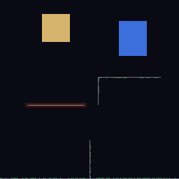

# The field, mocked

2026-11-28. An experiment for `docs/ZETA-RECIPROCAL-DESIGN.md` section 4.4. **Not law, not silicon,
and not connected to the machine at all**: a standalone draft of the step, in whole numbers and scan
order only, to see whether a 4,096-entry table and a trace can carry a world.

    python3 experiments/field/field.py      # field.gif and the numbers below

A 256 x 256 window. Sand (yellow) and water (blue) start as blocks in the air over stone ledges
(grey, then green as moss takes them). The orange glow is trace: where the player is looking.

## The step, as drafted

- **Matter**, 3 bits a cell, in blocks of 2 x 2 whose origin alternates. Four kinds index a table; the
  table answers four kinds and three gate bits.
- **Gates**: COIN (only if the block's coin came up), WARM (only if the block's trace is at or above
  `GATE`), COLD (only if below).
- **Trace**, 8 bits a cell: (4t + N + S + E + W) >> 3, less `DECAY`, floored at zero; deposits first.
- **The coin**: one bit a block from a 16-bit shift register, stepped once a block in scan order.

## What was found [m, on the mock]

| | |
|---|---:|
| the table | 4,096 x 15 bits = 61,440 bits: **six block RAMs exactly** |
| entries of it this rule uses | 889 |
| sand, before / after 1,500 steps | 1,600 / 1,600 |
| water, before / after | 2,000 / 2,000 |
| two runs from one seed | the same, to the bit |
| moss on the watched ledge: watched / not watched | **0 / 162** |
| moss everywhere else, the same two runs | 623 / 623 |
| a step of the window at a word a clock | 131,072 words, 18.2% of a frame [a] |

- **A block rule conserves what it is written to conserve.** Not a grain or a drop is lost or made in
  1,500 steps, with no bookkeeping: a block can only rearrange what is in it.
- **The reciprocal part works, and it is one gate bit.** Moss takes stone only where the trace is cold.
  The ledge the player watches stays bare; the same ledge unwatched grows 162 cells of it; nothing
  anywhere else differs by a cell between the two runs.
- **It is exact.** Same seed, same world.

## Corrections to the design

- The design gave the table two gate bits and waved at "the kinds reversed" for growth where trace is
  absent. It needs a third bit, COLD. Fifteen bits an entry still fits the six blocks the design counted.
- The design did not say which cell's trace gates a block. The mock uses the block's top-left cell. It
  has to be said.

## What went wrong on the way, and what it means

- **Moss that grows from moss floods the world.** The first rule let moss spread from moss; it filled
  both halves, watched and unwatched, in 1,500 steps. A rule that makes matter needs a bound written
  into it. Here: moss grows only against stone.
- **A sparse gaze changes nothing.** Deposits on every fourth cell, two rows off the ledge, never raised
  the trace between them to `GATE`: 344 cells of moss watched, 344 unwatched. Trace spreads and halves
  each step, so a deposit warms its own cell and little else. Whatever writes "seen" into the field has
  to write it densely, or `GATE` and `DECAY` have to be chosen against the deposit's spacing.
- **Water levels slowly.** After 1,500 steps the water on its ledge is still a mound. A block moves a
  cell a step at most and this rule only slides a drop when the cells above are empty. Real water needs
  a better rule or more steps a frame; it is the rule's fault, not the engine's.

## Not measured

- Any silicon, any timing, the SDRAM. The 18.2% is arithmetic on a supposed word a clock.
- The window moving across a larger world.
- Drawing it through a texture page.
- The deposits here are placed by hand. Nothing yet turns the retina's answers into them.
