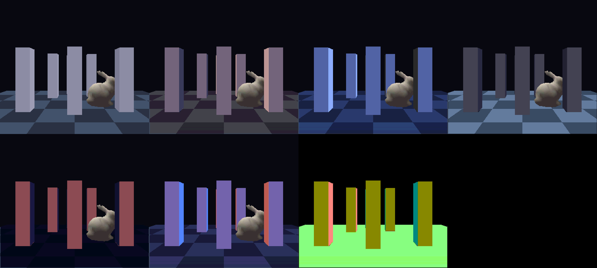
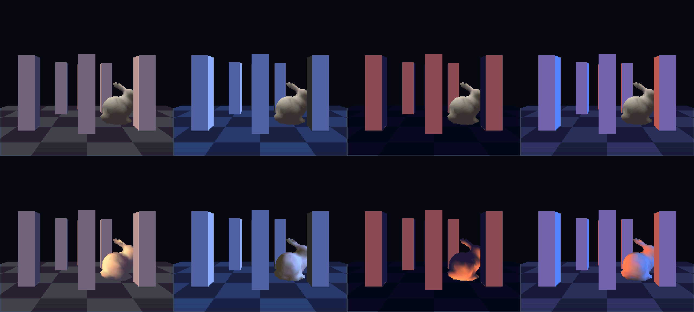

# Light a pixel, mocked on the room

2026-11-28. An experiment for `docs/ZETA-RECIPROCAL-DESIGN.md` section 4.1. **Not law, not silicon.**
`light.py` takes the plate of `carts/examples/room.zol` as the law seeds it (a colour and a depth a
pixel), gives every pixel one more byte naming its normal, and relights the room through a 256-entry
table and one multiply a channel:

    shown = min(31, (plate colour * TABLE[normal byte]) >> 4)       16 = unchanged, 31 = 1.94x

The plate never changes. Only the table does.

    python3 experiments/light/light.py      # sheet.png, sheet_body.png, film.gif

## 1. The room under six tables

Left to right, top to bottom: as baked; a warm lamp, left; a cold lamp, right; from above only; a fire
on the floor; two lamps; the recovered normals. The body here keeps the law's own light.

| [m, on the law's plate] | |
|---|---:|
| plate pixels with a depth | 44,032 of 92,160 |
| ...where a normal was recovered from the depth plane | 43,538 (98.9%) |
| distinct normal bytes the room uses | 21 of 256 |
| error of one byte against the recovered normal, degrees | median 5.8, 95th 7.4, worst 11.8 |

- **It works as a picture.** A pillar's lit side follows the lamp; the floor answers a lamp above and
  goes dark under a fire below; two lamps of two colours split each pillar.
- **One byte is enough for a room like this.** It would band on a smooth sphere at a grazing angle:
  256 directions is a 16 x 16 grid. Not examined.
- **Normals can be recovered from a depth plate, with one trap.** The first draft judged "facing the
  camera" by the normal's depth component, which a floor does not have; the floor flipped between up
  and down in stripes. Judged against the ray to the pixel it is clean. A baker should still write the
  true normal: the 494 pixels with none are all edges.

## 2. The body, lit at the load from the same table

Top row: the body as the law lights it today. Bottom row: each corner's normal is turned with the body,
looked up in **the room's own table**, and written where its gouraud colour was. The law then draws the
body exactly as it draws any gouraud body; nothing downstream of the load is changed.

- **This is what makes the idea whole.** In the top row the bunny is pasted onto four different rooms.
  In the bottom row it stands in them: warm on the lamp's side, lit from beneath by the fire, split
  red and blue between two lamps like the pillars beside it.
- **It is the load's work, not the pixel's.** 200 corners, one lookup each, once a frame. The corners
  use 132 of the 256 normal bytes [m].
- **It needs nothing the law lacks but the table.** `OBJ_LIT` already turns a corner's normal into a
  colour before the clipper (`gpu._geom`, `vattr`); this replaces its one light with a lookup.

`film.gif` is 96 frames of the same thing moving: a lamp circling and guttering while the bunny walks
behind the pillars, the table rewritten on every frame.

## What it still shows is missing

- **Nothing casts a shadow.** The table knows a normal, not what stands between it and the lamp. The
  pillars do not shade the floor and the bunny has no shadow under it. The plate's baked shadow bit
  answers for one fixed sun and no more.
- **A lamp has a direction, not a place.** Every surface facing the same way is lit the same wherever it
  stands; the fire lights the far pillar as much as the near one. The design's four zones are the only
  answer offered, and they are not mocked.
- **The plate's colours were baked already lit.** The pillars' sides are darker in the plate itself, so
  the table tints a shaded colour. A plate meant for this would be baked unlit.
- **The body's albedo is a guess** (`BODY_ALBEDO`): its baked gouraud colours already had light in them.

## Not measured

Any cost. The plate's lookup is one more block-RAM read in the pump's path and the multiply is the tint
the commit pipeline has; the body's is a lookup a corner at the load. None of it is built, fitted or timed.
