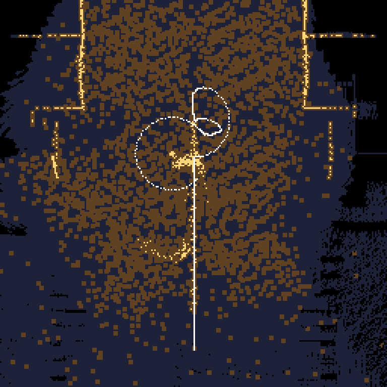

# Closing the loop on a real route: sight into the field

2026-11-28. An experiment for `docs/ZETA-RECIPROCAL-DESIGN.md`. **Not law, not silicon.** It joins the
two mocks before it (`experiments/retina`, `experiments/field`) on TND's scripted tour, 901 frames, with
the law's render unchanged and its depth plane borrowed.

    python3 experiments/loop/loop.py        # about two minutes: map.png, loop.gif, the tables

## The question

The field's README ended on what was missing: nothing turns what was seen into deposits, and a sparse
gaze warms nothing.

**The first idea does not survive TND.** Deposit at each seen object's position: but TND's town pieces
all sit at the origin with their meshes in world space [m: the object list's x and z span exactly the
camera's own]. An object's position says nothing about where its pixels are.

**What the machine already answers is better.** `PICK_Z` is the depth standing at a pixel the program
chose. A pixel, its depth and the camera are a point in the world: where the eye landed. So each frame
the program picks K pixels, and the next frame deposits at the K world cells their depths name. The law
has one pick a frame; the design proposes eight. How many does it take?

## What was found [m, on the law, TND tour]

The truth is every second pixel of every frame, unprojected into a 256 x 256 window at eight cells a
world unit.

**Of everything the glass showed (pixels x frames), the share that fell on cells the picks marked:**

| picks a frame | a pick marks 1 cell | 3 x 3 cells | 5 x 5 cells |
|---:|---:|---:|---:|
| 1 (the law today) | 5.3% | 25.9% | 45.1% |
| 8 (the design) | 26.9% | 72.2% | **92.6%** |
| 32 | 52.5% | 95.5% | 98.6% |
| 128 | 84.6% | 99.0% | 99.7% |

**Of the cells sight ever touched, even once, the share marked:**

| picks a frame | 1 cell | 3 x 3 | 5 x 5 |
|---:|---:|---:|---:|
| 1 | 0.9% | 7.3% | 17.6% |
| 8 | 6.3% | 35.5% | 56.7% |
| 32 | 19.7% | 60.8% | 74.0% |
| 128 | 45.7% | 77.7% | 89.5% |

- **Eight picks a frame, each marking a 5 x 5 patch, account for 92.6% of what the player was shown**
  over fifteen seconds. One pick, as the law has now, accounts for under half.
- The two tables differ because picks fall where the pixels are. A cell glimpsed once at the horizon is
  rarely marked; a wall that filled the glass always is. For "what did the player look at" the first
  table is the right one.
- **A pick must mark a patch, not a cell.** At one cell a pick, even 128 a frame reach 85%. This is the
  field's sparse-gaze finding again, measured: the deposit list wants a rectangle an entry.
- The picks move every frame along a fixed sequence. A program can compute it; a fixed grid of eight
  would see the same eight rays forever.

## The plan of the town, learned by looking

Top down, far is up. Dim blue: every cell sight ever landed on. Brown: cells marked by eight picks a
frame. **Bright: cells where a pick landed above the ground.** White: where the camera went.

The bright lines are the street's walls and corners. Nothing told the field where they are: 7,208
depth answers over fifteen seconds drew them. The cluster on the camera's path is the bodies.

`loop.gif` plays the route beside the trace the field would hold, frame by frame.

## What this changes in the design

- Eight picks is a defensible number and is now a measured one, on one route.
- The deposit list should take a rectangle an entry (cell, width, height, amount).
- "Deposit where the object is" should be struck: it is wrong for any cart that bakes its world into
  meshes at the origin, and TND is one.
- The per-object percepts (BOX, FOV, LUM) and the picks answer different questions. The percepts say
  *what* was seen and how well; the picks say *where in the world* sight fell. The loop needs both.

## Not measured

- Real play. The tour is a script; a player looks at things for reasons.
- The unprojection as the program would do it, in whole numbers on 262,144 instructions a frame. Here
  it is floating point. Eight picks are eight multiplies and two rotations each: small, but unwritten.
- The camera's pitch sign and roll are untested by this route beyond producing straight walls.
- Any silicon. Eight watched pixels are eight compares at the flush in place of one.
