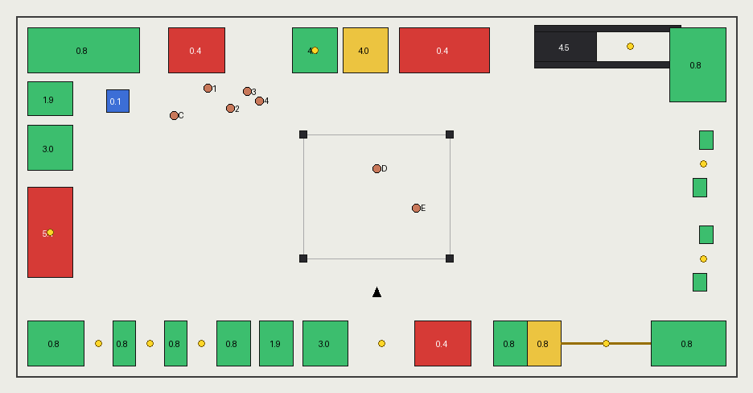

# The yard: one room for the whole moveset (TND layer 13, P70)

The player, 2026-11-24: "design a new lab room, something that would be a good
playground for the full moveset" -- and, of the design: "looks fine get to work".

The lab tests fists in a box and the park tests the run down a corridor; neither
lets them be chained. The yard is the lab's hall (64 by 32) with the park's rows
in it: a ring in the middle, a track round the walls, a range beside the ring.

(`python3 experiments/yard/plan.py experiments/yard/plan.png` draws it from the
cart's own rows: green a plain jump, red a power move, yellow a mover, black a
wall, blue a mark; the numbers are tops; E the elite, D the double, C the common,
1-4 the horde; the triangle is where he begins.)

| zone | what it is for | made of |
|---|---|---|
| the RING | the tank's and the boxer's strings, dodges, hitstop and knock, on the double and the elite | four posts; the lab's bodies |
| the TRACK | the run: taps, steps, a flip down, a slider (south); pads (east); a chimney, a lift, a ledge, a flip down (north); steps and a tower (west) | 36 of the park's boxes and movers, 8 orbs |
| the RANGE | the gun: a firing pad, five bodies at 5, 8, 10, 11.5 and 12.6 units, each on a bearing of its own | the lab's bodies (a round flies 13 units, tapped or charged) |

The `who` knob picks who stands: everyone; the ring alone; the range alone; the
double alone; the elite alone; all but the double.

## The room is data

The park's course is a function unfolded as he runs. The yard's is a table: 41
rows written into the cart's data once (`YARD_BOXES` in `games/tnd/gen_tnd.py`),
read through the same window of eight. Nothing in the program knows the layout;
another room is another table.

## What it costs (first cut)

A minute of walking, fists, the run, jumps, dives and shots at random
(3,860 frames), all seven bodies standing:

| | the yard | limit |
|---|---|---|
| VM instructions a frame, median / worst | 27,581 / 39,444 | 65,536 |
| objects, worst | 46 | 64 |
| frame clocks (simulated silicon), median / peak | 53% / 73% | 90% gate |
| data memory free | 290 | -- |

## Not in the first cut

The tower (the dive onto a body below), the gauntlet, the items (key, gate, a
beam to slide under), targets that are not bodies (moving, pop-up), a lap clock,
drills. The east, north and west sides of the track are laid from the park's
measured reaches but only the south side is run by a test.
